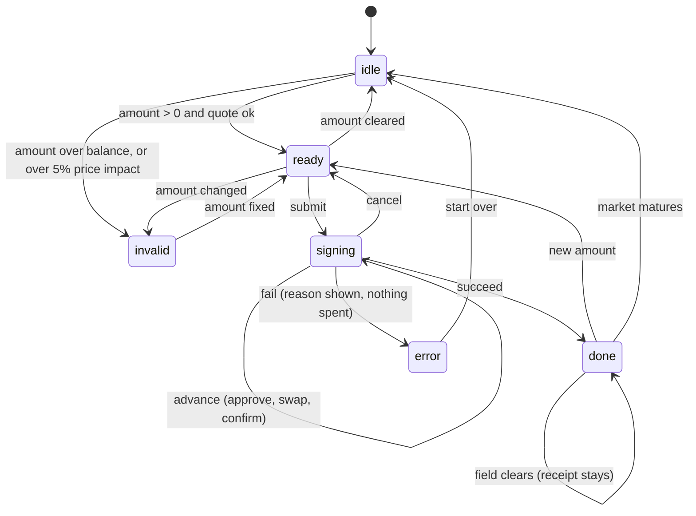

# Trade flow statechart

Source of truth: `web/src/lib/flow.ts`. The trade card renders from this state only.

## Rules the UI enforces

| Rule | Where |
|---|---|
| Inputs are locked while signing; a second submit is ignored | `flow()` ignores `input` and `submit` in `signing`; `LoadingButton` ignores clicks while pending |
| A failed or cancelled trade never changes balances | `onExecute` runs only after the last step |
| Quotes that would buy PT above par, or move the pool more than 5%, are refused | `quoteFixed` / `quoteBet` in `web/src/lib/sim.ts` |
| Amount input accepts digits and one decimal point, 15 integer digits at most | `cleanAmount` in `TradeCard.tsx` |
| After maturity the trade form is replaced by a closed panel; redemption uses hold to confirm | `TradeCard.tsx`, `PositionCard.tsx` |

## Scenarios checked in the browser (2026-11-03)

| Scenario | Result |
|---|---|
| Lock 2,500 MUSD fixed | 2,505.94 MUSD at maturity, 1.50% after fee and impact |
| Buy YT with 100 MUSD | 14,328 YT, break-even 4.62% |
| One week at 8% sMUSD | 20.88 MUSD claimable (matches 14,328 x 8% x 7/365 x 0.95) |
| Triple click on submit | One execution |
| `?fail=swap` | Step 2 marked failed, reason shown, wallet unchanged |
| Over-balance and 15-digit amounts | Inline reason, button disabled, no quote nonsense |
| 390 x 844 | No horizontal scroll after the `min-w-0` fix |
| 1024 x 768 | Primary button inside the first screen with a quote shown |
| Maturity | Closed panel, "Closed" rate tile, PT redeemable |

Full automated run (screenshots, `.webm` video, contrast): `node web/qa/visual-proof.mjs` with the dev server up.
